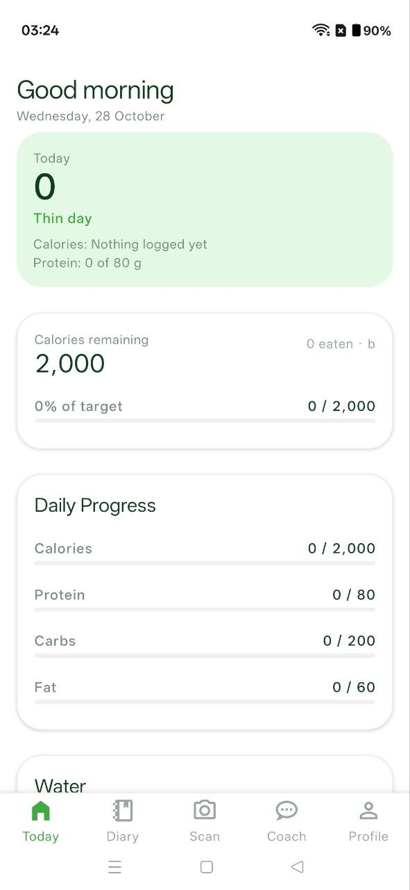
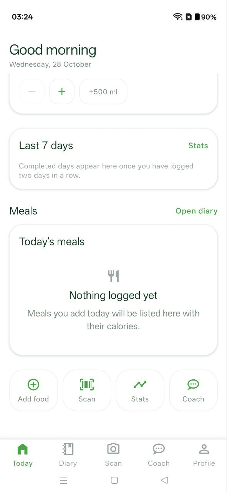
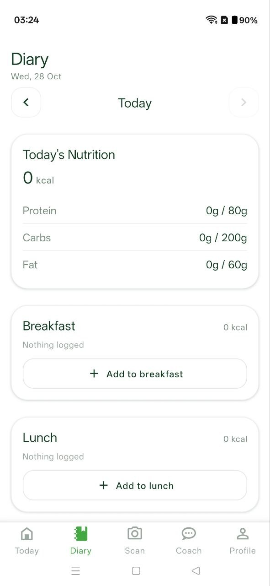
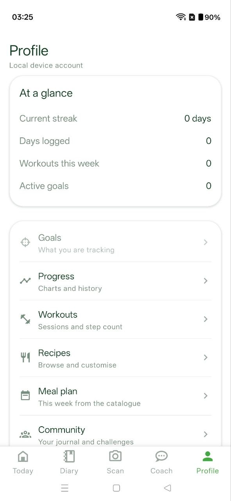
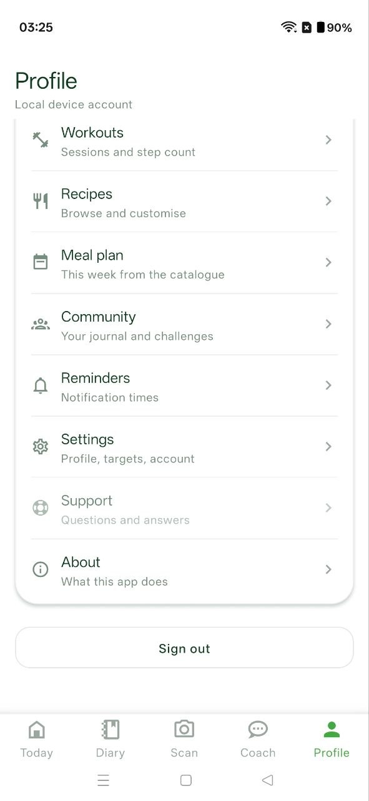
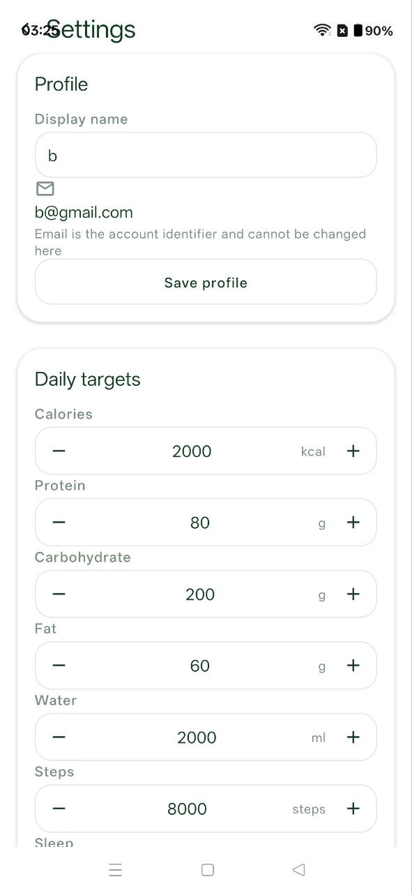
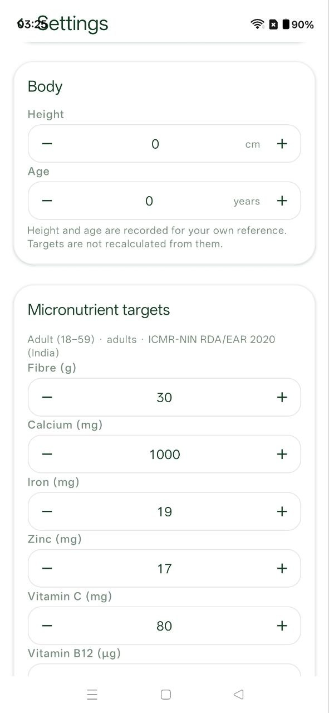
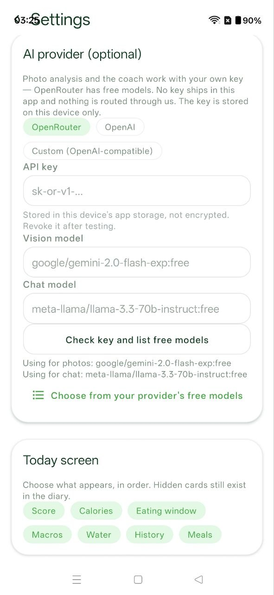
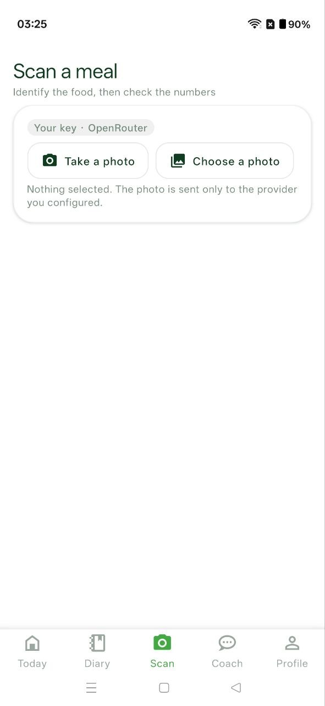
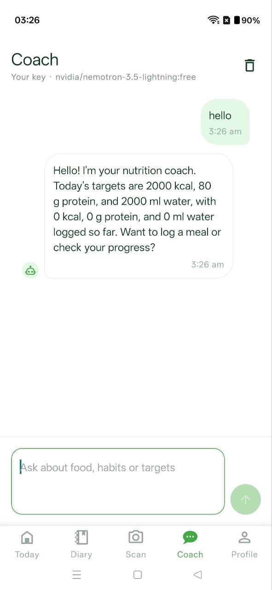

# BiteWise

**A nutrition diary that assumes Indian home cooking, no signal, and no account.**

Most trackers are built around barcodes, restaurant portions and a cloud login.
BiteWise is built around the opposite: a dal you cooked yourself, a kitchen with no
signal, and a diary that never leaves your phone. 174 foods, 105 Indian dishes,
twelve micronutrients against Indian reference intakes — and AI that only runs if
you hand it your own key.

<p>
  <a href="https://github.com/ItsAakif/Bitewise/actions/workflows/build-apk.yml"></a>
  
  
  
  
  <a href="https://github.com/ItsAakif/Bitewise/releases/latest"></a>
</p>

---

## Screens

Captured on a phone with an empty account, because the empty state is what most
trackers get wrong: it should say what will appear, not show you a zero and call it
a day.

<table>
  <tr>
    <td align="center"><br><sub><b>Today</b> — remaining calories, macro progress, water</sub></td>
    <td align="center"><br><sub><b>Today, continued</b> — last seven days, meals, quick actions</sub></td>
  </tr>
  <tr>
    <td align="center"><br><sub><b>Diary</b> — the day split by meal, totals pinned above</sub></td>
    <td align="center"><br><sub><b>Profile</b> — streak, days logged, workouts, goals</sub></td>
  </tr>
  <tr>
    <td align="center"><br><sub><b>Profile, continued</b> — recipes, planning, reminders, settings</sub></td>
    <td align="center"><br><sub><b>Targets</b> — calories, macros, water, steps, sleep</sub></td>
  </tr>
  <tr>
    <td align="center"><br><sub><b>Micronutrients</b> — ICMR-NIN 2020 reference intakes, per life stage</sub></td>
    <td align="center"><br><sub><b>AI provider</b> — optional, your key, your device</sub></td>
  </tr>
  <tr>
    <td align="center"><br><sub><b>Scan a meal</b> — photo or gallery, sent only to your provider</sub></td>
    <td align="center"><br><sub><b>Coach</b> — answers built from your own logged numbers</sub></td>
  </tr>
</table>

---

## Why it exists

**Generic entries don't describe home food.** "Dal" is not a fixed number. BiteWise
ships 105 Indian dishes as first-class rows, in grams, and lets you correct any
catalogue value so the app learns your version of a dish rather than the average.

**Logging the same meal three times a week is tedious.** Meal Memory stores the
exact items and portions you logged, so repeating breakfast is one tap — with the
same numbers, not an approximation.

**Numbers without context are decoration.** Every insight states its own
arithmetic: how many days were examined, how many fell short, against which target.
If the evidence is thin, it says that instead of drawing a conclusion.

**Cloud-first trackers make you trade privacy for a food diary.** Everything is
local by default. The only things that leave the device are the requests you
trigger, to a provider you chose.

---

## What's inside

| | |
|---|---|
| **Diary** | Day-by-day log with per-meal sections, item editing and water |
| **Add food** | Search, sentence parser, barcode (Open Food Facts), or read a label |
| **Meal Memory** | Save a meal once, log it again in a tap |
| **Micronutrients** | 12 tracked against ICMR-NIN 2020, unknown values marked unknown |
| **Insights** | Recurring gaps, protein consistency, weekday vs weekend — with working |
| **Score** | One number per day, with a breakdown that sums to it |
| **Energy** | Expenditure learned from your weight trend, with confidence bands |
| **Cook** | Recipe catalogue, URL import, 7-day planning, shopping list |
| **Train** | Set-level logging, "last time" per exercise, volume history |
| **Portability** | JSON backup, per-day CSV, version-checked restore, dataset import |

Full matrix, dependencies and deliberate omissions: **[FEATURES.md](FEATURES.md)**.

---

## Quick start

Requires Node 20+.

```bash
npm install
npm run web:build && npm run web:serve     # http://localhost:8099
```

No account, no key, no configuration. On a phone instead:

```bash
npm start        # scan with Expo Go (SDK 52)
```

## Download

The current APK is attached to **[Releases](https://github.com/ItsAakif/Bitewise/releases/latest)**.
It is signed with the standard React Native debug key and built by the same workflow
that runs the checks, so Android will ask you to allow installation from an unknown
source. That is the normal prompt for any APK that is not distributed through Play.

A Play Store release needs `targetSdk 35`; Expo SDK 52 targets 34, so store submission
requires an SDK upgrade first. Direct distribution does not.

## Build an APK

The native project is generated, so `android/` is not committed.

```bash
npx expo prebuild --platform android
cd android && ./gradlew assembleRelease
```

No local SDK? Push to GitHub — `.github/workflows/build-apk.yml` lints, runs the
test suite, builds a release APK and uploads it as an artifact. Add
`GOOGLE_SERVICES_JSON` and `EXPO_ENV` as repository secrets to include Firebase and
Google sign-in.

---

## How the AI is wired

Bring your own key — OpenRouter (free tiers), OpenAI, or any OpenAI-compatible
endpoint. Settings lists the free models *your* key can reach. No key ships here and
nothing is proxied through this project.

**The model identifies; the app computes.** A photo returns
`{ name, catalogueId, grams, confidence }` against a closed list of catalogue rows.
The app then looks up the real row and does the portion maths from its own data. A
model asked *"how many calories is this?"* answers confidently and wrongly; one
asked *"which of these rows is it?"* is doing a job it can do. Foods it names that
the catalogue lacks are shown as unmatched rather than given invented numbers.

Retrieval for the coach is weighted token overlap over 174 rows — no embeddings, no
vector store, sub-millisecond, on device.

---

## Design rules

1. **One owner per number.** Intake lives in `nutrition`, body state in `health`.
2. **Never invent data.** A missing micronutrient is *unknown*, not zero.
3. **SI only.** A serving is grams or millilitres.
4. **Tokens only.** No literal hex, fontSize or borderRadius in a component.

---

## Verification

```bash
npm run verify    # lint + state + routes + styles + 121 behavioural checks
```

| Gate | Catches |
|---|---|
| `lint` | Dead imports, hook misuse, undefined identifiers |
| `verify:state` | A selector reading a key the store does not have |
| `verify:routes` | Navigation to a route that was never registered |
| `verify:styles` | `transform: undefined` — crashes every button on device |
| `smoke` | Reducers, macro maths, ICMR-NIN values, portions, migration, CSV, backup, barcode mapping, retrieval, insights |

Each gate exists because it caught a real defect that bundling did not.

---

## Layout

```
App.js                  hydrate → auth → day rollover → navigator
src/app/                boot sequence
src/config/             env, Firebase, auth mode
src/theme/              the only design tokens
src/data/               174 foods, recipes, workouts, FAQ, legal
src/utils/              dates, maths, search, parser, planner, insights
src/services/           auth, storage, HTTP, AI provider, import/export
src/redux/              ten slices, hydration, debounced persistence
src/components/         primitives and domain blocks
src/screens/            33 screens
scripts/                the verification harness
```

---

## Documentation

- **[FEATURES.md](FEATURES.md)** — what each feature needs, and what is not built
- **[FIREBASE.md](FIREBASE.md)** — project setup, Google sign-in, the SHA-1 step
- **[LICENSE](LICENSE)** — MIT

---

## Data and honesty

The catalogue was written for this project: typical values for the stated serving,
internally consistent, and **not laboratory measurements**. No third-party
composition dataset is redistributed here. Open Food Facts is queried at runtime
under its own licence and attributed in the app.

This is not medical advice. Targets are numbers you set.

## Privacy

Diary, history, weight, workouts, goals and settings live in AsyncStorage on your
device. No analytics, no tracking SDK, no account required. The only outbound
requests are ones you trigger: a barcode lookup, a recipe URL, or your AI provider.

## Known limitations

AI requests have not been exercised against a live provider in this repo; retrieval,
pricing and parsing are tested, the HTTP round-trip is not. No automated UI tests.
Micronutrient figures are authored estimates. Twelve recipes. No cross-device sync.
AsyncStorage rather than SQLite. Health Connect, on-device models and label OCR are
unbuilt.

---

MIT © BiteWise contributors
